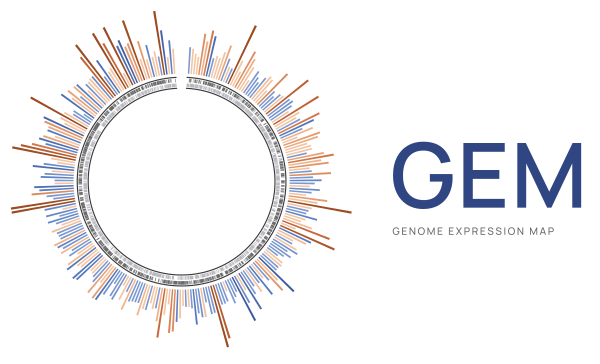

# GEM — Genome Expression Map (genomemap 1.0.0)

Circular and linear genome maps of bacterial RNA-seq results, for any annotated genome (multi-contig and plasmids included). Several treatment-vs-control pairs can be compared and switched between in one map.

**For users:** open `dist/genome_map_viewer.html` in a browser and drag in your files. Start with `docs/USER_GUIDE.md`.

| Folder | Contents |
|---|---|
| `dist/genome_map_viewer.html` | the viewer: one self-contained file, works offline |
| `docs/USER_GUIDE.md` | how to use it: which files, what the numbers mean, limitations |
| `docs/INPUT_FORMATS.md` | exact column specifications of every input file |
| `docs/data_model.md` | dataset JSON format and Mode A computation; audit of the 2026 R10.79 viewer |
| `docs/TEST_REPORT.md` | what was tested, against what, and the results |
| `templates/` | empty `samplesheet`, `contrasts`, `landmarks`, `labels` tables |
| `example_R10.79/` | *not in this repository* (unpublished data, kept private). Use `tests/synthetic_DC3000/` to try the viewer. |
| `dist/genomemap.py` | the command-line builder as one self-contained file (same commands; carries the whole source) |
| `cli/` | optional command-line builder (`genomemap_build.py`; needs Python ≥ 3.9 and Node.js ≥ 18) |
| `src/` | source of the viewer (`genomemap-core.js` contains all parsing and computation) |
| `tests/` | test scripts, fixtures (NCBI DC3000 GFF3/GBFF, Prokka-style GFF), synthetic data; `bash tests/run_all_tests.sh`. The R10.79 regression steps need the private data set and fail without it. |
| `assets/logo/` | GEM logo (SVG/PNG) |

Two modes:
- **Mode A**: raw counts + sample sheet → size factors, normalised counts and descriptive log2 fold changes computed in the browser. No p-values.
- **Mode B**: DESeq2 / edgeR / limma result tables → log2FC and padj shown as they are.

Rebuild the viewer after editing `src/`: `python cli/genomemap_build.py viewer -o dist/genome_map_viewer.html`.
